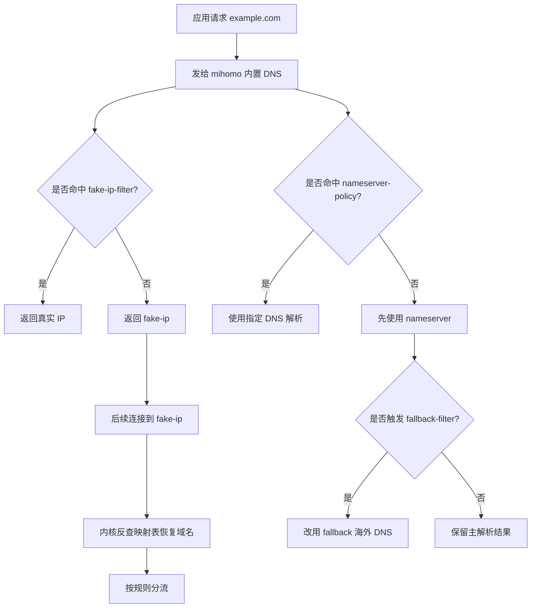

# Fake-IP 与 DNS 配置说明

## 1. 背景
`FlClash` 基于 `Clash Meta / mihomo` 内核，因此它的 DNS 与 `fake-ip` 逻辑可以按 `mihomo` 的官方配置文档理解。

参考资料：

- `FlClash`：<https://github.com/chen08209/FlClash>
- `mihomo DNS`：<https://wiki.metacubex.one/en/config/dns/>
- `mihomo DNS resolve process`：<https://wiki.metacubex.one/en/config/dns/diagram/>

## 2. Fake-IP 是什么
`fake-ip` 的核心做法是：当应用请求域名时，内核不一定立刻返回真实 IP，而是先返回一个保留网段中的“假 IP”，例如 `198.18.0.23`，同时在本地保存一条映射：

```text
example.com -> 198.18.0.23
```

之后应用去连接这个假 IP 时，内核会反查映射表，恢复出原始域名 `example.com`，再按域名规则分流。

它的主要价值有两个：

1. 减少 DNS 污染影响。
2. 保留域名信息，方便后续规则按域名分流。

## 3. Fake-IP 与 Redir-Host 的区别
- `redir-host`：优先返回真实 IP，后续更多依赖嗅探、SNI、Host 等信息补回域名。
- `fake-ip`：先返回假 IP，再由内核把连接映射回原始域名。

对于“国内直连、国外代理、未知默认代理”的模板，`fake-ip` 通常更稳定，因为它更容易保证域名规则被命中。

## 4. 当前配置的整体逻辑
当前 `clash/config.yaml` 中的 DNS 配置目标是：

- 国内域名：优先用国内 DNS 解析，并最终直连。
- 明确的国外域名：必要时改用海外 DNS，并走代理。
- 局域网、私有域名、本地直连域名：不使用 `fake-ip`，直接返回真实 IP。
- 其他大多数域名：先交给 `fake-ip` 托管，再由规则系统决定最终路由。

简化流程如下：



## 5. 关键配置项说明

### `enable: true`
启用内置 DNS。关闭后会更多依赖系统 DNS，分流精度和抗污染能力都会下降。

### `listen: 127.0.0.1:1053`
内置 DNS 监听的本地地址与端口。这里使用 `1053`，主要是为了降低和系统 `53` 端口冲突的概率。

### `enhanced-mode: fake-ip`
启用 `fake-ip` 模式，是这一套 DNS 设计的核心开关。

### `fake-ip-range: 198.18.0.1/16`
指定假 IP 地址池。`198.18.0.0/15` 是常见的保留测试网段，适合用于本地映射。

### `fake-ip-filter-mode: blacklist`
黑名单模式表示：命中 `fake-ip-filter` 的域名返回真实 IP；未命中的域名返回假 IP。

### `fake-ip-filter`
这里放“不适合使用 fake-ip”的域名，例如：

- `geosite:private`
- `+.lan`
- `+.local`
- `+.home.arpa`
- `rule-set:my_direct_domain`

这类域名常见于局域网、本地服务、自建服务或需要直连的域名。如果给它们返回假 IP，可能会导致 NAS、路由器、打印机等本地服务异常。

### `default-nameserver`
用于解析 `nameserver`、`fallback` 这些 DNS 服务器自身的域名。它通常要求写成 IP，避免“解析 DNS 服务器时还要再依赖 DNS”。

### `proxy-server-nameserver`
专门用于解析代理节点域名。这样做的重点是让订阅节点或代理服务器本身尽快被稳定解析出来，减少“代理还没建立，DNS 就先卡住”的问题。

### `nameserver-policy`
这是非常关键的字段。它的作用是：把某些域名强制交给指定的 DNS 上游解析。

当前配置中，下面这些规则集会优先走国内 DNS：

- `private_domain`
- `cn_domain`
- `my_direct_domain`

这能保证：

- 国内域名优先得到国内视角的解析结果。
- 内网域名或自定义直连域名不会跑去问海外 DNS。

### `direct-nameserver`
当某个目标最终被规则判定为“直连”时，可以再使用 `direct-nameserver` 做一次更贴近直连出口的解析。

### `direct-nameserver-follow-policy: true`
表示 `direct-nameserver` 也遵循 `nameserver-policy` 的规则，不会绕开前面的 DNS 指定策略。

### `nameserver`
主解析器。当前配置选择国内 DoH，主要目的是提高基础可用性与解析稳定性。

### `fallback`
备用解析器，通常配置为海外 DNS，例如：

- `https://8.8.8.8/dns-query#PROXY`
- `https://1.1.1.1/dns-query#PROXY`

这里加上 `#PROXY` 的意义是：通过代理去访问海外 DNS，降低直连海外 DoH 时被污染、阻断或超时的风险。

### `fallback-filter`
决定什么情况下要启用 `fallback` 结果。当前思路是：

- 主解析先走国内 DNS。
- 如果域名明显属于海外站点，或者结果疑似不可信，则改用 `fallback`。

这部分是“抗污染”逻辑的重要组成部分。

## 6. 为什么说 Fake-IP 只是整套方案的一部分
严格来说，真正帮助解决 DNS 污染的不是 `fake-ip` 单独一个开关，而是下面几部分共同作用：

1. 内置 DNS 接管解析流程。
2. `nameserver` 与 `fallback` 分层。
3. `fallback-filter` 判断何时使用海外结果。
4. `#PROXY` 让海外 DNS 查询经过代理。
5. `fake-ip` 保留域名语义，帮助规则系统稳定命中域名规则。

所以可以把它理解为：

- `DNS 配置` 负责尽量拿到正确结果。
- `fake-ip` 负责让“结果”和“后续规则分流”衔接得更稳定。

## 7. Fake-IP 的副作用
`fake-ip` 很有用，但也有副作用：

1. 某些局域网服务不兼容。
2. 某些应用需要真实 IP。
3. 排障时看到的是 `198.18.x.x`，不如真实 IP 直观。
4. 和 TUN、嗅探、系统 VPN 等功能叠加时，配置复杂度会上升。

因此需要用 `fake-ip-filter` 把不适合 `fake-ip` 的域名排除掉。

## 8. 当前配置适合你的原因
这套配置比较适合当前仓库的目标：

- 国内流量优先直连。
- 国外流量优先代理。
- 无法明确判断的流量最终默认代理。
- 局域网、自定义直连域名不被 `fake-ip` 干扰。

这是一种偏保守、偏稳定的多平台模板写法。

## 9. 后续可以继续优化的方向

### 方向一：继续补 `fake-ip-filter`
如果后续发现某些本地服务、设备发现协议、局域网工具有异常，可以把相关域名继续加入 `fake-ip-filter`。

### 方向二：引入 `sniffer`
`sniffer` 可以在部分场景下从流量里补回域名信息，进一步提高规则命中率。但它会增加配置复杂度，建议在当前模板稳定后再考虑。
